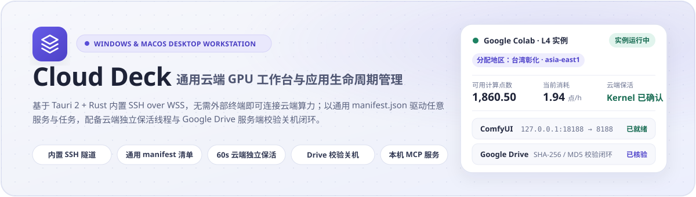
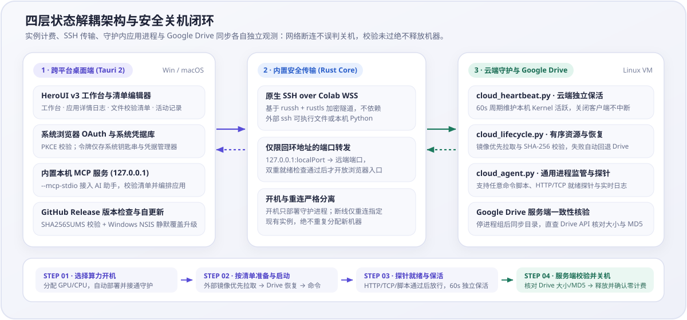
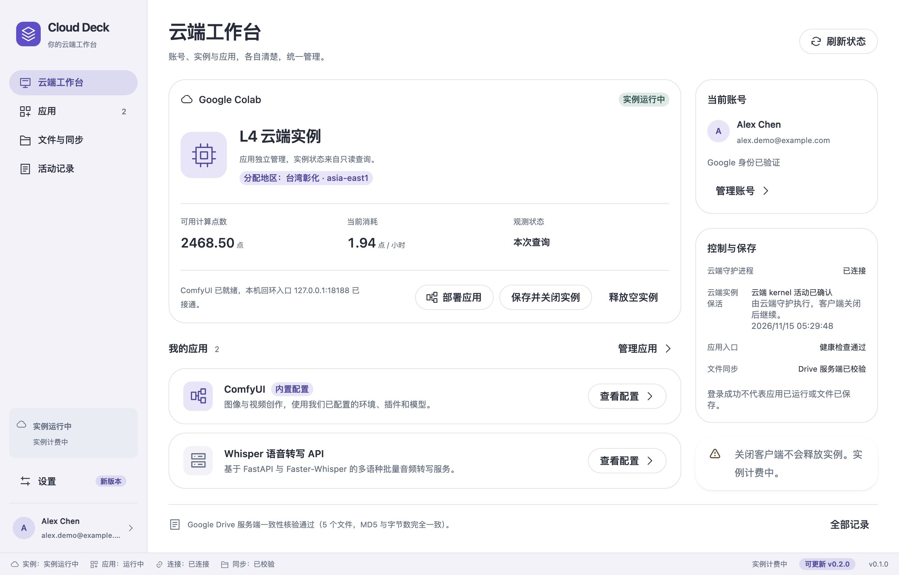
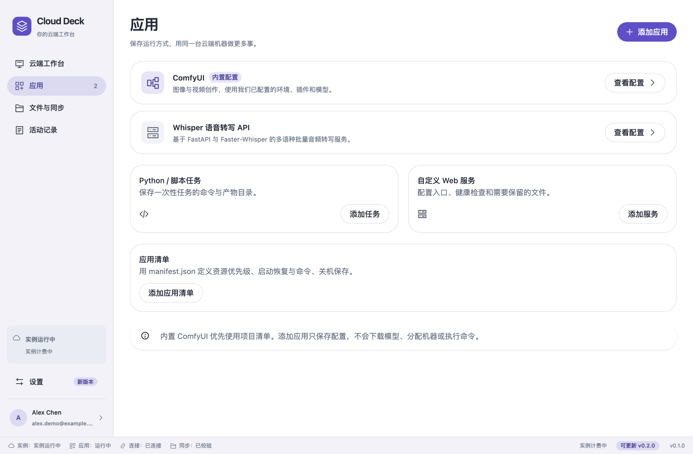
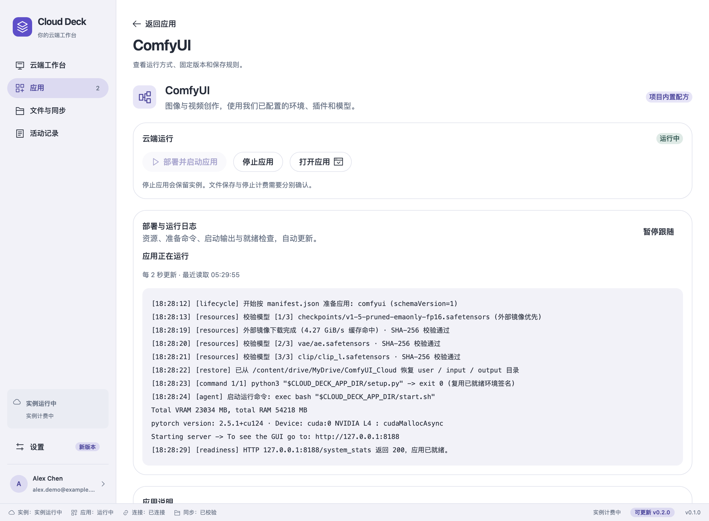
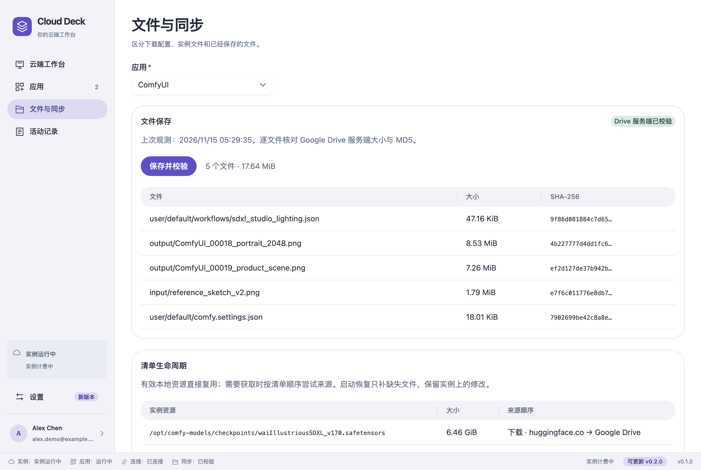
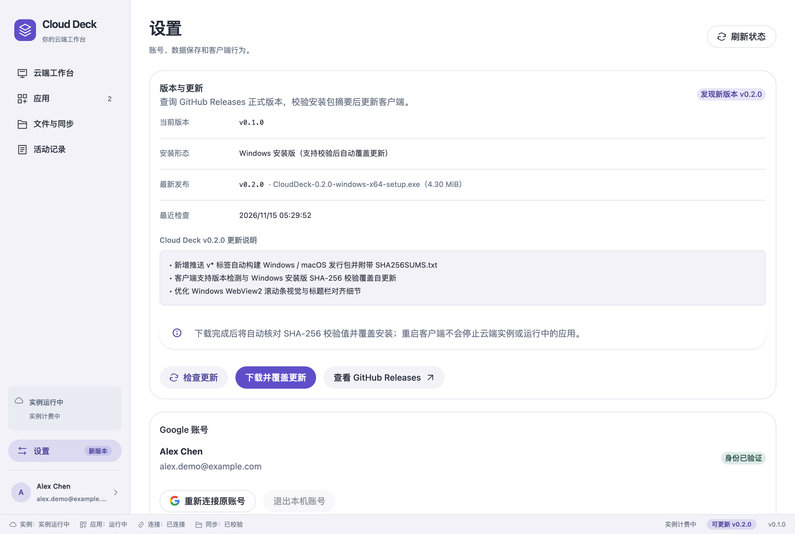

<p align="center">
  
</p>

<p align="center">
  <a href="https://github.com/rezoch340/cloud-deck/releases">
    
  </a>
  
  
  
</p>

<p align="center">
  <a href="client/README.md">客户端手册</a> ·
  <a href="client/applications/README.md">应用清单规范</a> ·
  <a href="workstation-design/DESIGN.md">架构设计稿</a> ·
  <a href="OAUTH-TEST.md">OAuth 实测记录</a> ·
  <a href="HANDOFF.md">交接记录</a> ·
  <a href="https://github.com/rezoch340/cloud-deck/releases">下载发行包</a>
</p>

---

**Cloud Deck** 是面向 **Windows 与 macOS** 的通用云端 GPU 桌面工作台（基于 Tauri 2 + React 19 + HeroUI v3 + Tailwind CSS v4 + Rust）。客户端以 **实例计费、隧道连接、云端应用、文件同步四态解耦** 为核心原则，在 Rust 原生后端内直接完成 Google OAuth、受保护的 `SSH over Colab WSS`、端口回环转发以及 Google Drive 服务端校验，无需最终用户安装外部 `ssh`、终端或本地 Python。**ComfyUI** 作为首个内置清单应用开箱即用，同时任何 Web 服务与命令行任务都可通过统一的 `manifest.json` 接入同一套生命周期引擎。

## 核心特性

| 能力维度 | 设计与实现 |
| --- | --- |
| **四维状态严格解耦** | **实例/计费**、**连接/转发**、**云端应用**、**文件同步** 各自独立观测与持久化。断网、隧道重连、查询失败或关闭客户端均不推断为“已关机”或“零计费”；存在活跃实例或未确认计费时拦截退出/切换账号。 |
| **零外部依赖原生隧道** | Rust 原生集成 `russh` 与 `tokio-tungstenite`，直连 Colab 受保护 WSS 代理并仅在 `127.0.0.1` 暴露回环转发端口，经远端健康探针与本机转发双确认后才开放浏览器入口。 |
| **通用 `manifest.json` 引擎** | 声明式定义运行命令、有序多源下载（外部镜像/Hugging Face 优先 + `size`/`sha256` 强校验 + Drive 自动回退）、缺失补齐恢复（不覆盖本地修改）、准备命令与 HTTP/TCP/命令就绪检查。内置 ComfyUI 锁定 `0.30.0` 与 34 项插件记录，排除 DLSS。 |
| **云端独立保活与实时日志** | 开机向实例部署通用 `cloud_agent.py`、`cloud_lifecycle.py` 与 `cloud_heartbeat.py`。心跳守护每 60 秒经实例本机回环 Jupyter API 发送轻量 kernel 执行并核对 `execute_reply`，不依赖桌面端在线，也不向实例上传桌面 OAuth 凭据；所有应用共用 2 秒轮询的部署/运行日志面板。 |
| **闭环保存与安全释放** | `保存并关闭实例` 严格按顺序执行：停止受管应用进程组 → 原子复制目录并版本化保留冲突备份 → 直连 Google Drive API 逐文件核验服务端字节大小与 MD5 → 二次复核无改动 → 释放实例并轮询确认 0 实例 / 0 点消耗。任一步失败立即阻断释放。 |
| **可信地区观测与本机 MCP** | 实例地区直接解析自 Colab 实际返回的代理主机，释放后保留并显式标注“上次分配地区”，绝不根据 GPU 型号或本机 IP 猜测。客户端内置 `127.0.0.1` 鉴权 MCP 服务与 `--mcp-stdio` 桥接，并支持 GitHub Release 校验升级。 |

## 系统架构与生命周期



架构自顶向下拆分为四层职责清晰的边界：

1. **桌面表现层（Tauri WebView · React 19 + HeroUI v3）**：工作台、通用应用、文件与同步、活动记录、设置五大视图共用外框与表单控件；不接触 Refresh Token，也不替云端臆测关机或同步完成状态。
2. **原生控制核心（Rust 后端）**：管理 PKCE 系统浏览器登录与系统凭据库（macOS Keychain / Windows Credential Manager）、Colab 只读配额/实例观测、原生 `SSH over WSS` 会话与 `127.0.0.1` 端口转发、本机鉴权 MCP Server，以及 GitHub Release 更新核验。
3. **受保护云端传输与代理层**：仅桌面端持有账号级 OAuth 授权；云端 Drive 授权按需由用户通过浏览器单独确认，令牌只在实例受控会话内使用，不回传桌面日志或报告。
4. **云端守护与应用执行层（Linux 实例内部）**：开机仅上传通用执行器与独立 `cloud_heartbeat.py`；部署具体应用时才按需下发其随包脚本并在 `/opt/cloud-deck/state/<app-id>.log` 留存实时输出，工作流遵循 **选卡开机 → 清单校验启动 → 保活与回环访问 → 停写/Drive API 核验/零计费释放** 四步闭环。

## 界面预览

### 1. 工作台总览与独立状态观测

完整区分“Google 账号 / 余额计费”“实测分配地区”“云端 Kernel 活动确认”与“通道连接状态”；存在新版本时在状态栏以低打扰胶囊提示 `可更新 vX.Y.Z`。



### 2. 通用应用中心与内置 ComfyUI 配方

ComfyUI 与任意自定义 Web 服务、后台任务并列运行于同一套清单规范；卡片直接呈现在实例上的运行状态、回环入口、模型数量及保存目标。



### 3. 实时部署运行日志与健康探针放行

所有服务与一次性任务详情页共用同一个日志面板，每 2 秒增量拉取云端 stdout/stderr、资源字节下载进度、Drive 恢复轨迹、准备命令退出码及 HTTP/TCP/命令就绪阶段，支持暂停自动跟随。



### 4. Google Drive 服务端一致性核验与资源清单

严格区分“静态模型下载配置”与“云端真实同步结果”；只有直接通过 Drive API 逐文件核对服务端大小与 MD5 成功后，才将同步状态标记为已校验并放行关机。



### 5. GitHub Release 版本检测与 SHA-256 校验更新

设置页“版本与更新”自动识别当前运行形态（Windows NSIS 安装版 / Windows 便携版 / macOS 应用包），展示发行说明并强制核对 `SHA256SUMS.txt` 后再覆盖升级或引导下载。



## 下载安装与版本更新

前往 [GitHub Releases](https://github.com/rezoch340/cloud-deck/releases) 获取发行包（每次正式版本推送均附带 `SHA256SUMS.txt`）：

| 平台与形态 | 发行文件名约定 | 来源与更新机制 |
| --- | --- | --- |
| **Windows x64（安装版）** | `CloudDeck-<version>-windows-x64-setup.exe` | GitHub Actions 自动编译发布；通过主程序同目录 `uninstall.exe` 识别 NSIS 安装形态，客户端下载同版本 `SHA256SUMS.txt` 与安装包完成常量时间 SHA-256 核验后，自动退出并以 `/P /UPDATE /R` 覆盖安装并重启（不中断云端实例）。 |
| **Windows x64（便携版）** | `CloudDeck-<version>-windows-x64-portable.zip` | GitHub Actions 自动编译发布（含绿色可执行文件与 `cloud/` 资源）；客户端检测到新版本后提示前往对应 Release 页面下载替换，避免误覆写便携目录。 |
| **macOS（本机签名构建）** | `CloudDeck-<version>-macos-*.dmg` / `.app.zip` | 由维护者在本机使用签名身份构建并按需补充上传至 Release；客户端在 macOS 下检测到新稳定版后展示更新日志，并一键在系统浏览器打开对应 GitHub Release 页面下载替换。 |

- 更新网络策略：客户端仅请求受信任的 HTTPS GitHub 官方域名（`api.github.com`、`github.com`、`*.githubusercontent.com`），跳过 draft 与 prerelease；启动 3 秒后后台检查一次，设置环境变量 `CLOUD_DECK_AUTO_UPDATE_CHECK=0` 可关闭自动检查。
- 标签自动发版：仓库维护者推送 `v*` 语义化标签（例如 `git tag v0.1.2 && git push origin v0.1.2`）将触发 [Release Workflow](.github/workflows/release.yml)，自动同步 4 处版本号、运行测试并构建 Windows x64（NSIS 安装包 + Portable ZIP）产物与 `SHA256SUMS.txt` 发布至 GitHub Releases；也可在 GitHub Actions 中使用 `workflow_dispatch` 执行演练打包（演练模式仅上传构建产物，不发布正式 Release）。macOS 包暂不由 CI 构建，保留本机单独打包。

## 通用应用清单与本机 MCP 接入

### 声明式 `manifest.json` 配方

任何可运行在 Linux 实例上的服务或一次性批处理都无需修改客户端源码，只需编写一份 `manifest.json`（示例见 [命令示例清单](examples/command-app/manifest.json)，完整字段见 [应用清单规范](client/applications/README.md)）：

```json
{
  "schemaVersion": 1,
  "id": "my-service",
  "name": "自定义模型服务",
  "description": "外部下载模型、启动前恢复目录、HTTP 就绪放行",
  "kind": "service",
  "runtime": {
    "command": "exec python3 /opt/my-service/server.py --port 8000",
    "workingDirectory": "/opt/my-service",
    "environment": { "PYTHONUNBUFFERED": "1" },
    "remotePort": 8000,
    "localPort": 18000,
    "readiness": { "type": "http", "url": "http://127.0.0.1:8000/health", "status": 200 }
  },
  "resources": {
    "files": [
      {
        "target": "/opt/my-service/weights.safetensors",
        "size": 104857600,
        "sha256": "<64位小写SHA-256>",
        "sources": [
          { "kind": "download", "url": "https://huggingface.co/.../weights.safetensors" },
          { "kind": "drive", "path": "/content/drive/MyDrive/MyService/weights.safetensors" }
        ]
      }
    ]
  },
  "startup": {
    "restore": [{ "source": "/content/drive/MyDrive/MyService/data", "target": "/opt/my-service/data", "optional": true }],
    "commands": [{ "command": "bash \"$CLOUD_DECK_APP_DIR/setup.sh\"", "workingDirectory": "/opt/my-service" }]
  },
  "shutdown": {
    "save": [{ "source": "/opt/my-service/data", "target": "/content/drive/MyDrive/MyService/data" }]
  }
}
```

### 本机 MCP（`--mcp-stdio` 桥接）

运行中的桌面客户端会在 `127.0.0.1` 随机端口开启鉴权 MCP HTTP 服务，并将连接信息以 `0600` 权限写入数据目录 `mcp.json`（拒绝无令牌/错令牌 `401` 与带 `Origin` 的浏览器请求 `403`）。支持 Codex / AI 客户端通过同一二进制的 `--mcp-stdio` 桥接调用 `get_workspace`、`refresh_status`、`validate_application`、`save_application`、`start_application`、`stop_application`、`application_logs` 等 10 项工具（实例申请、释放及 Google 登录仅限桌面窗口确认）：

```toml
# macOS 示例
[mcp_servers.cloud-deck]
command = "/Applications/Cloud Deck.app/Contents/MacOS/cloud-deck"
args = ["--mcp-stdio"]
```

```toml
# Windows NSIS 安装版示例（使用自定义数据目录时附加 "--data-dir", "<数据目录>"）
[mcp_servers.cloud-deck]
command = "%LOCALAPPDATA%\\Programs\\Cloud Deck\\cloud-deck.exe"
args = ["--mcp-stdio"]
```

设置环境变量 `CLOUD_DECK_MCP=0` 可在启动客户端时禁用本机 MCP 服务。

## 仓库目录结构与开发验证

```text
cloud-deck/
├── .github/workflows/release.yml   # v* 标签自动测试、Windows 打包与 GitHub Release 发布
├── client/                         # 跨平台桌面客户端（Tauri 2 + React 19 + HeroUI v3 + Rust）
│   ├── src/                        #   页面、HeroUI 共用组件、状态模型、样式与前端单测
│   ├── src-tauri/                  #   原生 OAuth、SSH/WSS 隧道、Drive API、MCP 与自更新模块
│   ├── applications/               #   内置应用配方（comfyui/）与清单规范文档
│   └── scripts/                    #   run.mjs 外置工作根统一入口与 sync-version.mjs 版本同步
├── docs/images/                    # README 系统架构图、横幅与高清界面预览图
├── examples/                       # 示例工作流与最小命令应用清单（examples/command-app/）
├── workstation-design/             # UI 交互与架构设计规范（DESIGN.md 及预览稿）
├── cloud_agent.py                  # 云端通用守护进程（应用生命周期、日志、端口状态）
├── cloud_lifecycle.py              # 清单驱动的资源校验、Drive 恢复与保存核验逻辑
├── cloud_heartbeat.py              # 60 秒独立 Jupyter kernel 心跳线程与状态持久化
├── test_cloud_*.py                 # 云端守护、生命周期与心跳离线单元测试
└── ComfyCloudApp/ · colab_mcp_server.py  # 原 Swift/Python 实现，仅作迁移基线保留
```

开发依赖（`node_modules`）、Cargo 编译缓存与安装包产物严格隔离在 **外部工作目录**，统一通过 `node client/scripts/run.mjs <mode>` 执行，绝不回落写入源码目录或系统临时目录（macOS 默认检查 `/Volumes/CODEX_SCRATCH` 下的 `.codex-scratch-volume` 挂载标记；Windows/Linux 或自定义路径需设置 `CLOUD_DECK_WORK_ROOT` 为绝对路径）：

```bash
# 查看实际生效的外置构建与缓存路径
node client/scripts/run.mjs paths

# 按锁文件安装前端依赖（在客户端构建/测试前执行一次）
node client/scripts/run.mjs install

# 校验 4 处客户端版本号是否一致（package.json / tauri.conf.json / Cargo.toml / Cargo.lock）
node client/scripts/sync-version.mjs 0.1.2 --check

# 启动前端浏览器预览（http://127.0.0.1:18774，配置仅保存在本地浏览器，不触碰云端）
node client/scripts/run.mjs dev

# 运行离线验证套件（不申请 Colab 实例、不触发 Google 登录）
node client/scripts/run.mjs test
node client/scripts/run.mjs web-build
node client/scripts/run.mjs rust-test
node client/scripts/run.mjs agent-test
node client/scripts/run.mjs format-check
```

更多关于构建产物路径、macOS 开发签名、`--region-fixture` 离线地区回归及经授权后的实机联调说明，请参阅 [client/README.md](client/README.md)。

## 验证状态与安全边界

- **macOS（Apple Silicon）实测状态**：已完整通过系统浏览器 PKCE OAuth 与钥匙串凭据刷新、Colab CPU 实例部署/回环转发/回收、内置 ComfyUI 在真实 T4 GPU 与 Google Drive 上的部署与一次 512×512 测试出图、Drive API 服务端逐文件大小与 MD5 核验、未校验改动释放拦截、应用重启恢复及完整“保存并关闭实例”后 0 实例 / 0 计费确认（详细报告见 [OAUTH-TEST.md](OAUTH-TEST.md) 与 [HANDOFF.md](HANDOFF.md)）。
- **Windows x64 状态**：已完成 `x86_64-pc-windows-msvc` 的 NSIS 安装包与便携版可执行文件交叉编译、Windows WebView2 细胶囊滚动条适配，以及包含版本对比/URL 白名单/SHA-256 流式验证在内的离线单元测试；Windows 真实硬件环境下的安装包升级、Credential Manager 凭据存取与完整云端链路仍待实机验收。
- **未逐项验收边界**：内置 ComfyUI 预设的 34 项第三方插件并非全部功能/生成质量均已完成逐一实测；且“云端 kernel 活动已确认”仅证明心跳正常响应，Google Colab 平台本身的运行时长、配额与资源回收策略依然适用。
- **凭据与发行说明**：旧基线私有目录 `auth/` 已列入 `.gitignore`，不参与新客户端运行或打包，切勿打印、提交或附带个人授权文件。公开发行正式版本前，需在 [client/src-tauri/src/auth.rs](client/src-tauri/src/auth.rs) 中配置产品独立注册的桌面 OAuth 客户端并完成 Google 审核验证。
